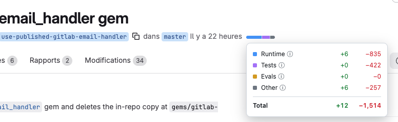

# diffspoiler

Shows how much of a pull request or merge request is runtime code, tests, evals or everything else, right next to the +/− counter.



A small bar (Runtime / Tests / Evals / Other) appears in the title line of every tab of a GitHub PR or GitLab MR. Hover it for the exact added and removed lines per bucket, plus the total. Works on `github.com` and `gitlab.com`, in Chromium browsers (Chrome, Arc, Brave, Edge).

## Install

- From the Chrome Web Store (unlisted): `<store link — coming soon>`
- Or load it unpacked: download `diffspoiler-<version>-chrome.zip` from the repo's Releases, unzip it, open `chrome://extensions`, enable Developer mode, click "Load unpacked" and select the unzipped folder.

No setup is needed on GitLab: it uses your logged-in session.

## GitHub token (optional)

- Public repos work without a token, through the GitHub API.
- Private repos without a token use your logged-in github.com session instead.
- If you hit the anonymous API rate limit, or want to skip the session fallback, add a fine-grained token with read-only "Pull requests" access in the extension's options page.

## How files are bucketed

Rules apply in this order: a snapshot under `__tests__/` counts as Tests, not Other.

| Bucket | What goes in it |
|---|---|
| Tests | `*.spec.*`, `*.test.*`, `__tests__/`, `test/`, `tests/`, `e2e/`, `*_test.go`, `test_*.py`, `*_spec.rb` |
| Evals | files under `evals/` or `eval/`, and `*.eval.*` |
| Other | lockfiles, `migrations/`, `dist/`, `vendor/`, `__generated__/`, `__snapshots__/`, `docs/`, `*.generated.*`, `*.min.js/css`, `*.snap`, `*.md`/`*.mdx`, JSON/YAML/PO files under `locales/` or `i18n/` |
| Runtime | everything else |

Paths are matched case-insensitively. Built-in rules only, no config file.

## Accuracy

- Every changed line is counted, from the per-file counts the platform already computes (no diff parsing). The total is the sum of what was counted.
- GitHub lists at most 3,000 files per PR. If the PR has more, the bar shows "not counted: N files".
- GitLab's own counter stops at 3,000 files. diffspoiler counts every file, and when its total differs from the page's counter a footnote explains why.
- If the data can't be read reliably (private repo while logged out, the platform changed its pages), the bar is hidden rather than showing a wrong number.

## Development

Requires Node 22 and pnpm 10.33.

```bash
pnpm install
pnpm test        # unit tests
pnpm typecheck
pnpm dev         # extension in dev mode with reload
pnpm build
pnpm zip         # store package in apps/extension/.output/
```

`packages/core` holds the pure classification and counting logic; `apps/extension` is the WXT (Manifest V3) extension.
